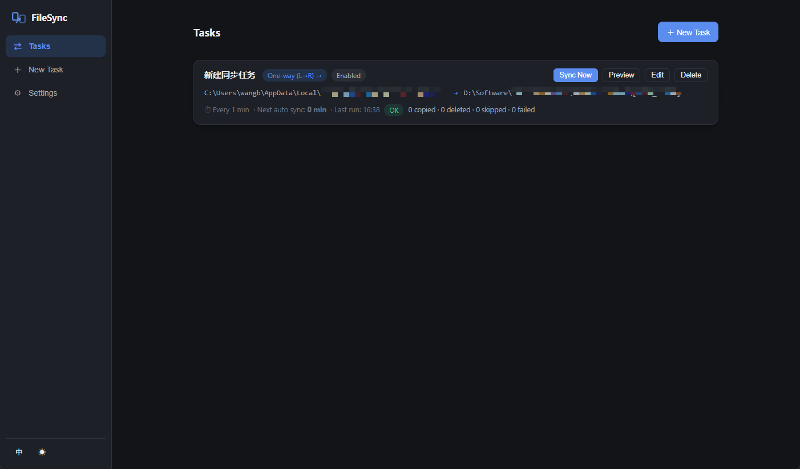
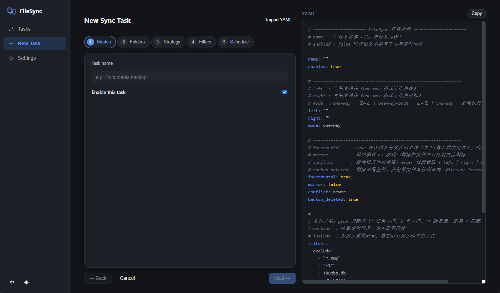
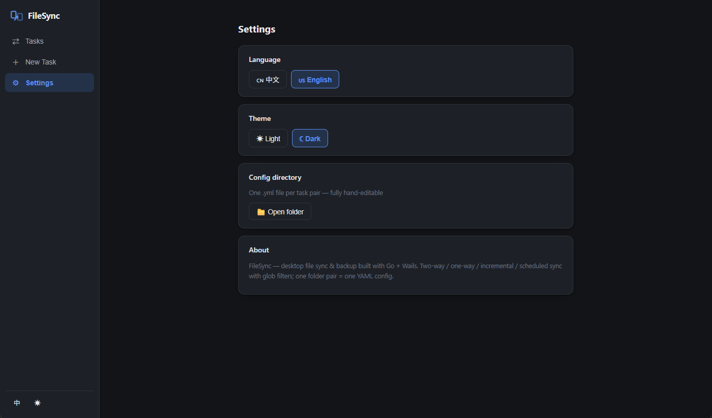

# FileSync 文件同步备份工具 · 使用说明

Go + Wails v2 + Vue 3 + TypeScript 构建的 Windows 桌面文件同步备份工具。

[English](README.md) · 简体中文

## 界面预览

| 任务列表 | 新建任务向导（YAML 实时预览） | 设置 |
|---|---|---|
|  |  |  |

*深色主题下的任务列表、五步向导与 YAML 所见即所得预览、多语言/主题设置页。*

## 功能一览

| 功能 | 说明 |
|---|---|
| 双向同步 | 两个文件夹互为镜像，两侧的新增/修改自动互相复制；配合状态清单可区分「删除」与「新增」，支持删除传播 |
| 单向同步 | 左→右 或 右→左，以源端为准复制到目标端 |
| 增量同步 | 按 文件大小 + 修改时间 比对，只同步有变化的文件，未变化文件自动跳过（预览中显示为 ✓N） |
| 定时同步 | 固定间隔（每 N 分钟）或 每天固定时刻（HH:MM），应用启动时自动补跑错过的任务 |
| 文件过滤 | .gitignore 风格 glob 规则：`*` 任意字符 · `?` 单字符 · `**` 跨目录 · 尾部 `/` 表示目录（如 `node_modules/`）；支持排除与包含（include 非空时仅同步匹配项）、大小写开关 |
| 多文件夹多任务 | 一个文件夹对 = 一个 YAML 配置文件（`{任务ID}.yml`），多个任务互不干扰 |
| YAML 所见即所得 | 向导左侧分步表单编辑，右侧实时渲染带中文注释的 YAML（保存后即为落盘配置）；支持「导入 YAML」粘贴已有配置反解析回表单 |
| 同步预览 | 执行前干跑：列出将要复制/删除/冲突的文件清单与统计，未变化文件计数显示 |
| 安全备份 | 删除或覆盖前，旧文件先移入目标目录的 `.filesync-trash/时间戳/` |
| 多语言 | 简体中文 / English，侧栏底部一键切换 |
| 黑白主题 | 浅色 / 深色主题，侧栏底部一键切换，跟随设置持久化 |
| 执行监控 | 同步进度条 + 实时日志流（按时间戳滚动），支持随时停止 |

## 快速开始

1. 运行 `FileSync.exe`（绿色单文件，无需安装）
2. 点击 **＋ 新建任务**，按向导 5 步填写：
   - 基本信息：任务名称
   - 同步文件夹：选择左右两个文件夹 + 同步模式（单向 左→右 / 单向 右→左 / 双向）
   - 同步策略：增量同步（建议开）、镜像删除、删除前备份、冲突策略（仅双向）
   - 文件过滤：排除规则（如 `*.tmp`、`node_modules/`）与包含规则
   - 定时任务：固定间隔或每天定时
3. 全程右侧 YAML 实时预览，确认无误后 **保存**
4. 任务列表中点击 **预览计划** 检查将发生的操作，再点 **立即同步**

## 配置文件位置

任务 YAML 与运行状态保存在用户配置目录（界面「设置 → 配置目录 → 打开目录」可直接跳转）：

- Windows：`C:\Users\<用户名>\AppData\Roaming\FileSync\tasks\*.yml`
- 状态清单：`...\FileSync\state\{任务ID}.json`（双向模式区分删除/新增的依据）

YAML 可手工编辑，保存后重启应用生效；也可以直接在应用内「导入 YAML」。

完整示例配置（文档备份任务）：

- 简体中文注释：[`docs/示例配置-文档备份.yml`](docs/示例配置-文档备份.yml)
- English comments: [`docs/example-config-documents-backup.yml`](docs/example-config-documents-backup.yml)

## 同步语义详解

### 单向模式（one-way / one-way-back）
- 源端有、目标端无 → 复制
- 两侧都有但内容不同 → 以源端为准覆盖
- 源端无、目标端有 → 勾选「镜像删除」则删除目标端多余文件，否则保留并在预览中提示

### 双向模式（two-way）
- 一侧独有的文件 → 复制到另一侧
- 两侧都有且不同 → 按冲突策略处理：`较新者胜`（默认）/ `以左侧为准` / `以右侧为准` / `跳过并报告`
- 删除传播：上次同步清单中两侧都存在的文件，本次一侧消失 → 判定为该侧删除；勾选「镜像删除」时传播删除到另一侧，未勾选则保留并持续提示
- 首次同步无历史清单，删除检测不可用（两侧独立文件视为新增）

### 增量判定
文件大小相同 **且** 修改时间相差 ≤ 1 秒 → 视为未变化跳过。复制时保留源文件修改时间，保证下次增量判定正确。

### 安全边界
- 应用自身目录 `.filesync-trash/` 与 `.filesync/` 恒被排除，不会回环同步
- 空目录不参与同步（仅同步文件）
- 执行中失败的单个文件不影响其余文件，失败清单在日志中以红色显示

## 从源码构建

依赖：Go 1.23+、Node 18+、Wails v2.10.1（`go install github.com/wailsapp/wails/v2/cmd/wails@v2.10.1`）。

PowerShell 一键构建（`build.ps1`）：

```powershell
.\build.ps1              # 前端构建 + 交叉编译 Windows exe
.\build.ps1 -Clean       # 清理后重建
.\build.ps1 -Package     # 构建 + 打包 ZIP
```

手动命令：

```powershell
cd frontend; npm install; npm run build; cd ..
$env:GOOS="windows"; $env:GOARCH="amd64"; $env:CGO_ENABLED="0"
go build -tags "desktop,production" -ldflags "-w -s -H windowsgui" -o build/bin/FileSync.exe .
```

## 浏览器演示模式

本项目前端内置 Mock 后端：直接用 `npm run dev` 在浏览器打开即为演示模式（模拟数据 + 模拟同步过程），便于无桌面环境时预览全部界面交互；桌面 exe 中则接入真实同步引擎。

## 已知边界

- 交付环境无 Windows GUI 运行时，exe 已通过 Go 全量单测（配置/过滤器/同步引擎/调度器 27 个用例）与前端 vue-tsc 零错误 + 无头浏览器界面实测，GUI 实机运行请以实机为准
- 不支持符号链接跟随、权限/属主同步、文件校验和级比对（以大小+mtime 为增量依据）

---
版本 1.0 · 2026-10-11 · Go 1.23 / Wails v2.10.1 / Vue 3.2 / TypeScript
